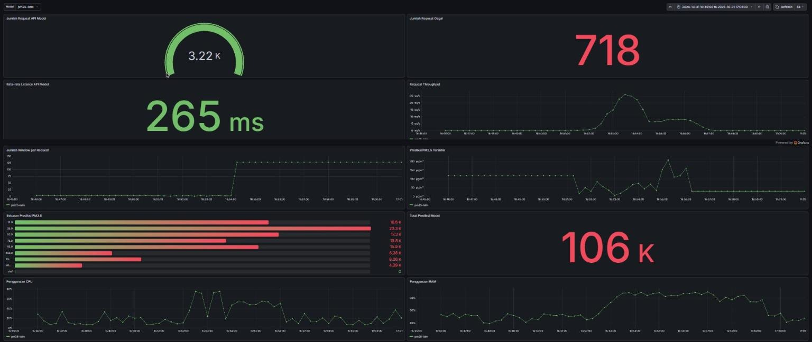
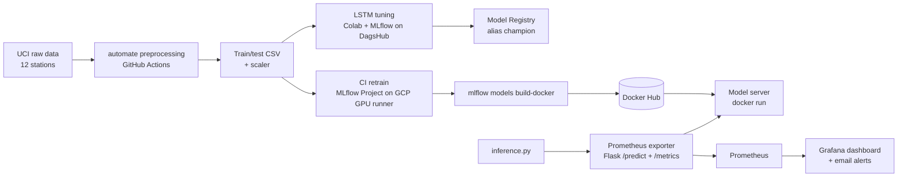
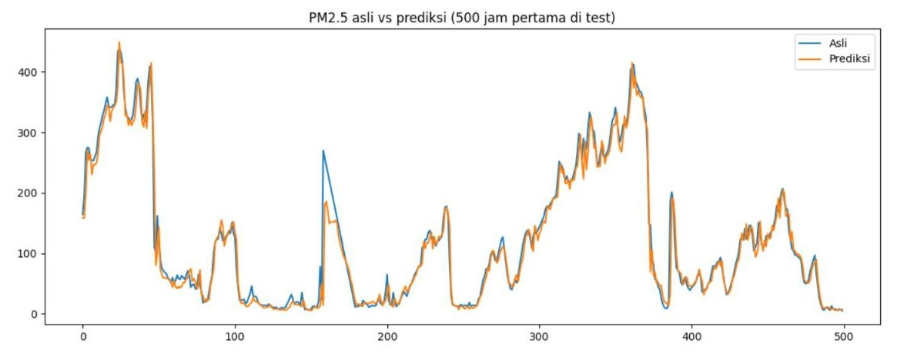
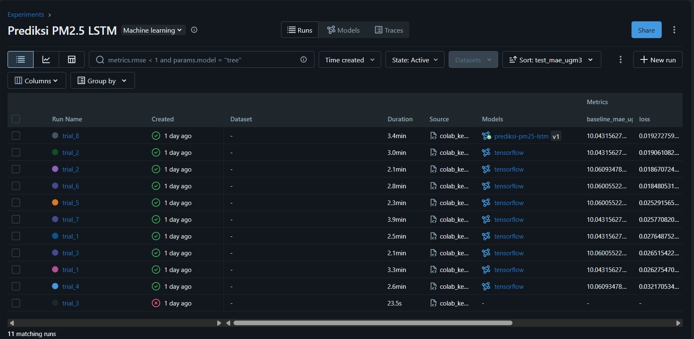
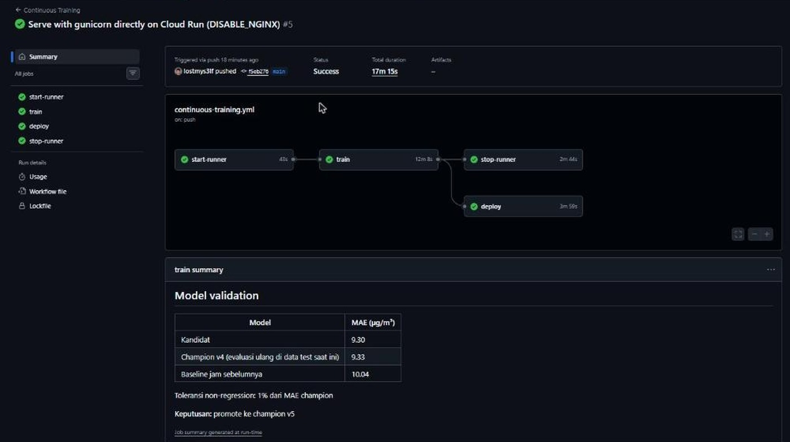
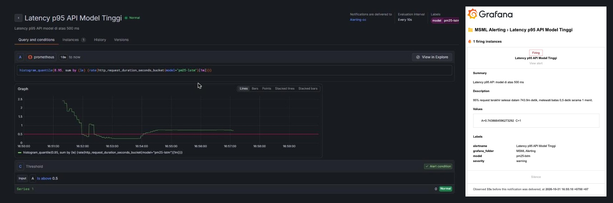
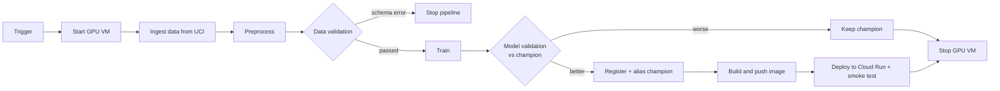

# PM2.5 Air-Quality Forecasting with End-to-End MLOps

An LSTM model that forecasts hourly PM2.5 concentration **one hour ahead** across 12 air-quality monitoring stations in Beijing, wrapped in a complete MLOps lifecycle: automated preprocessing, experiment tracking, CI retraining on a GPU runner, containerized serving, and production-style monitoring with alerting.

Built as the final project of the Dicoding course *Membangun Sistem Machine Learning* (Building Machine Learning Systems).



## Highlights

| Area | What was built |
|---|---|
| Model | LSTM forecaster on ~420K hourly records, tuned with an 8-trial random search |
| Accuracy | **MAE 9.30 µg/m³** on the held-out year, **7% lower** than a naive persistence baseline (10.04) |
| Tracking | MLflow on DagsHub with manual logging, extra artifacts, and a Model Registry alias (`champion`) |
| CI/CD | GitHub Actions on a self-hosted GCP GPU runner (NVIDIA L4): retrain, store artifacts, build and push a Docker image |
| Continuous training | Google MLOps Level 1 pipeline: data validation, model validation against the champion, registry promotion, automated Cloud Run deployment |
| Serving | MLflow model server image on Docker Hub, deployed to Cloud Run (scale to zero) |
| Monitoring | Prometheus exporter with **13 custom metrics**, a 10-panel Grafana dashboard, and **3 golden-signal alerts** |

## Architecture



## 1. Experiment and preprocessing

The notebook covers EDA and preprocessing, and `automate_mardi-jefri.py` applies exactly the same steps as a script so the dataset can be rebuilt by a GitHub Actions workflow on every push.

- Linear interpolation per station for missing values, with a known stuck sensor value (O3 = 1071) treated as missing.
- Wind direction encoded as sine/cosine, station one-hot encoded.
- Time-based split: training data before 2016-03-01, the following year as the test set, with a `StandardScaler` fitted on training data only.

## 2. Modelling and experiment tracking

Each trial is logged manually to MLflow on DagsHub with per-epoch metrics, the model, and extra artifacts (loss curves, prediction plot, model summary, metric info). The best trial is registered as `prediksi-pm25-lstm` with the alias `champion`.

| Setting | Value |
|---|---|
| Input window | 48 hours, 25 features |
| Architecture | LSTM 64 → LSTM 32 → Dense 8 → Dense 1 |
| Loss | Huber, Adam (lr 0.0003), early stopping |
| Test MAE / RMSE | 9.30 / 17.33 µg/m³ |



*Actual (blue) vs predicted (orange) PM2.5 for the first 500 hours of the test set.*



## 3. CI retraining pipeline

`ci.yml` retrains the model through an MLflow Project whenever the project changes (or on manual dispatch), commits the `mlruns` artifacts back to the repository, then builds a serving image with `mlflow models build-docker` and pushes it to Docker Hub with two tags: `latest` and the MLflow `run_id`. The job runs on a self-hosted runner on a GCP VM with an NVIDIA L4 GPU.



## 4. Serving, monitoring, and alerting

The model image runs as a container, and `prometheus_exporter.py` sits in front of it: it forwards `/predict` requests to the model server and exposes metrics at `/metrics`.

| Group | Metrics |
|---|---|
| API | request count, failed requests, latency histogram, throughput, in-progress requests |
| Model | request window count, last prediction (µg/m³), prediction distribution by air-quality band, total predictions |
| System | CPU, RAM, disk, exporter process memory |

The Grafana panels use `increase(...[$__range])` and `rate()`, so totals stay correct across exporter restarts. A `model` label set in `prometheus.yml` drives a dashboard dropdown, so more models can be monitored from the same dashboard.

Alerts follow the four golden signals from the Google SRE book and send email notifications:

| Alert | Signal | Condition |
|---|---|---|
| Latency p95 API Model Tinggi | Latency | p95 latency > 500 ms for 1 minute |
| Error Rate API Model Tinggi | Errors | > 5% failed requests for 1 minute |
| Penggunaan RAM Server Tinggi | Saturation | RAM usage > 90% for 1 minute |

All three were validated with a load test using real test data, and each fired and delivered its notification.



## 5. Continuous training pipeline (MLOps Level 1)

`.github/workflows/continuous-training.yml` automates the whole training pipeline, following the [Google Cloud MLOps Level 1](https://docs.cloud.google.com/architecture/mlops-continuous-delivery-and-automation-pipelines-in-machine-learning) design:



| Level 1 component | Implementation |
|---|---|
| Pipeline triggers | Weekly schedule, manual dispatch, `repository_dispatch` API event (for example a drift alert), and code changes |
| Data validation | `pipeline/validate_data.py` stops the run on schema skew (columns, types, missing values, stations, split dates) and reports value skew as a standardized mean difference against reference statistics |
| Continuous training | `pipeline/train.py` retrains with the same model code as experimentation, on a GPU runner that the workflow starts and stops on demand |
| Model validation | `pipeline/validate_model.py` re-evaluates the current champion on the same test set; the candidate is promoted only if it beats both the champion and the naive baseline |
| Metadata management | Every run logs parameters, metrics, the data validation report, the model validation report, git SHA, and trigger type to MLflow on DagsHub |
| Continuous delivery | Promoted models get a new registry version and the `champion` alias, then the image is pushed and deployed to Cloud Run with a smoke test |

GCP access uses Workload Identity Federation (no service account keys), set up once with `pipeline/gcp_setup.sh`.

## Repository structure

```
├── .github/workflows/  continuous training pipeline (MLOps Level 1)
├── 01-experiment/      EDA notebook, automate preprocessing script, preprocessing workflow
├── 02-modelling/       baseline training (autolog) and tuning with manual logging to DagsHub
├── 03-ci-pipeline/     original CI retraining workflow, MLproject, conda.yaml, CI training script
├── 04-monitoring/      Prometheus config, exporter, inference client, Grafana dashboard and alert rules
├── pipeline/           ingest, data validation, training, model validation, GCP setup script
└── assets/             README images
```

Code comments are written in Indonesian.

## How to run

```bash
# 1. Download the raw data from UCI into beijing_air_quality_raw/ at the repository root, then preprocess
python 01-experiment/automate_mardi-jefri.py

# 2. Train (MLflow tracking server at http://127.0.0.1:5000)
python 02-modelling/modelling.py --data_dir 01-experiment/beijing_air_quality_preprocessing

# 3. Serve the model and start the exporter
docker run -d --name pm25-model -p 5005:8080 mardijefri/prediksi-pm25-lstm:latest
python 04-monitoring/prometheus_exporter.py

# 4. Start Prometheus with 04-monitoring/prometheus.yml, then send requests
python 04-monitoring/inference.py
```

To monitor the Cloud Run deployment instead of a local container, start the exporter with `MODEL_URL=<cloud-run-url>/invocations`.

To reuse the monitoring setup, import `04-monitoring/grafana/dashboard.json` into Grafana and provision `04-monitoring/grafana/alert-rules.yaml` after setting your Prometheus data source UID.

## Links

- Experiment repository (automated preprocessing): https://github.com/lostmys3lf/Eksperimen_SML_mardi-jefri
- CI repository (workflow runs and artifacts): https://github.com/lostmys3lf/Workflow-CI_mardi-jefri
- MLflow tracking on DagsHub: https://dagshub.com/lostmys3lf/pm25-lstm-model
- Docker image: https://hub.docker.com/r/mardijefri/prediksi-pm25-lstm

## Tech stack

Python, TensorFlow/Keras, pandas, scikit-learn, MLflow, DagsHub, GitHub Actions, Google Cloud Platform (Compute Engine, NVIDIA L4, Cloud Run, Workload Identity Federation), Docker, Flask, Prometheus, Grafana.

## Dataset

Chen, S. (2017). *Beijing Multi-Site Air Quality* [Dataset]. UCI Machine Learning Repository. https://doi.org/10.24432/C5RK5G (CC BY 4.0)

## Author

Mardi Jefri · [LinkedIn](https://linkedin.com/in/mardi-jefri) · [GitHub](https://github.com/lostmys3lf)
